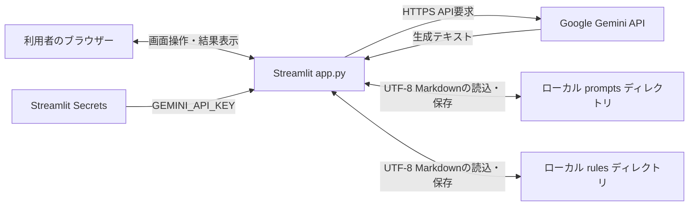

# AI指示文管理ツール 基本設計書

## 1. 文書情報

| 項目 | 内容 |
|---|---|
| 文書名 | AI指示文管理ツール 基本設計書 |
| 作成基準 | `app.py`の現行実装および追加要求 |
| システム形態 | Streamlitによる単一アプリケーション |

## 2. システム構成

### 2.1 構成要素

| 構成要素 | 役割 |
|---|---|
| Webブラウザー | Streamlit画面の表示と入力。 |
| Streamlitアプリケーション | 画面描画、入力検証、ファイル操作、生成API呼び出しを実行する。 |
| Google Gemini API | 利用者の要望から指示文を生成する外部サービス。 |
| `prompts`ディレクトリ | 生成・作成したプロンプトをMarkdownファイルとして永続化するローカル領域。 |
| `rules`ディレクトリ | 生成したルールをMarkdownファイルとして永続化し、プロンプト生成時の選択肢を提供するローカル領域。 |
| Streamlit Secrets | `GEMINI_API_KEY`をアプリケーションへ提供する。 |

### 2.2 アーキテクチャ方針

- `app.py`をエントリポイントとする単一スクリプト構成。
- UI、アプリケーション制御、ファイル永続化、外部API呼び出しは同一ファイルに記述される。
- Streamlitのスクリプト再実行モデルを利用し、生成結果は`st.session_state`に保持する。
- DBや独立したバックエンドサービスは設けず、ファイルシステムをデータ保存先とする。
- MVC等の明確なレイヤー分離は現行実装にない。

## 3. 画面設計

### 3.1 共通

- ページタイトル：`AI指示文管理ツール`
- レイアウト：wide
- 画面上部のタイトル行右端に「更新」ボタンを配置する。
- 更新ボタン押下時、セッション内のウィジェット値と生成結果を初期化し、生成対象を初期値「プロンプト」に戻す。
- 初期化後の再実行で`rules/*.md`を再列挙し、新しく保存されたルールもオプションルール欄に表示する。
- 画面は共通ヘッダーと以下の2領域で構成する。

### 3.2 AIによる指示文作成

画面の表示順は、生成対象、要望入力、オプションルール、生成実行とする。

| 項目 | 内容 |
|---|---|
| 生成対象 | 「プロンプト」「ルール」の二択。利用者は生成前にどちらか一方を選択する。 |
| 要望入力 | 複数行テキスト。空白のみの入力は生成時に拒否する。 |
| オプションルール | `rules`直下のMarkdownファイルごとに、ファイル名（拡張子を除く）をラベルとするチェックボックスを表示する。複数選択可能。 |
| 生成ボタン | 選択した生成対象と要望をGemini APIへ送信する。プロンプトの場合は選択ルールの本文も送信する。処理中はスピナーを表示する。 |
| 生成結果 | 生成後にファイル名（初期値「新しい指示文」）と本文を編集可能な状態で表示する。 |
| 保存ボタン | ファイル名・本文を検証し、生成対象に応じたフォルダへMarkdownとして保存する。 |
| 通知 | 入力警告、生成エラー、保存結果を表示する。 |

オプションルールはプロンプト生成にのみ適用し、ルール生成時は選択内容を生成要求に含めない。`rules`にMarkdownファイルがない場合、選択肢なしで生成できる。

### 3.3 保存済み指示文の管理

| 項目 | 内容 |
|---|---|
| 検索入力 | ファイル名と本文を対象に部分一致検索する。大文字・小文字は区別しない。 |
| 件数表示 | 現在の検索条件に一致するファイル数を表示する。 |
| 操作選択 | 「新規作成」または「既存の指示文を編集」を選択する。 |
| 新規作成 | 名前と本文を入力し、同名ファイルがなければ保存する。 |
| 既存編集 | 一覧からファイルを選択し、本文を編集する。ダウンロードと上書き保存ができる。 |
| 空の検索結果 | 該当する指示文がない旨を表示する。 |

## 4. データ設計

### 4.1 永続データ

- 保存先：`Path(__file__).parent / "prompts"`および`Path(__file__).parent / "rules"`
- 対象：それぞれの直下にある`*.md`
- 形式：Markdownテキスト
- 文字コード：UTF-8
- プロンプトの保存パス：`prompts/<入力名>.md`
- ルールの保存パス：`rules/<入力名>.md`
- オプションルール一覧は`rules/*.md`から取得し、各ファイルの本文を生成時に読み込む。
- 新規作成・生成結果保存は重複名を拒否する。既存編集は選択ファイルに上書きする。

### 4.2 セッションデータ

| キー | 用途 |
|---|---|
| `reset_app` | 画面右上の更新ボタン。ボタン自身の状態以外を初期化する操作を実行する。 |
| `generation_type` | 生成対象（プロンプト／ルール）を保持する。初期値は「プロンプト」。 |
| `generated_prompt` | AIが生成した成果物本文。利用者の編集内容もこのキーで保持する。 |
| `generated_type` | 直近の生成結果の対象種別を保持し、保存先決定に使用する。 |
| `generated_name` | 生成結果の保存ファイル名。初期値は「新しい指示文」。 |
| `option_rule_<ファイル名>` | 各ルールのチェック状態を保持する。 |
| `ai_request` | 生成要望入力ウィジェットの状態。 |
| `manage_mode` | 管理画面の操作モード。 |
| `new_name` / `new_content` | 新規作成画面の入力状態。 |
| `edit_<ファイル名>` | 選択した指示文の編集内容。 |

セッション状態はStreamlitセッションの範囲であり、アプリケーションをまたぐ永続データではない。

## 5. 外部インターフェース設計

### 5.1 Gemini API

- SDK：`google.genai`の`genai.Client`
- 認証情報：`st.secrets["GEMINI_API_KEY"]`
- モデル：`gemini-3.8-flash`
- 入力：生成対象に応じたテンプレートと利用者の要望。プロンプト生成時は、選択したルールの名前および本文を追加する。
- 出力：選択対象に応じたプロンプトまたはルール。`response.text`を生成結果として扱う。
- 空の応答本文はエラーとして画面表示する。
- APIキー欠落、モデル利用可否、通信、利用制限等を含む例外時は共通エラーを表示し、例外詳細をcaptionに表示する。

## 6. 処理フロー

### 6.1 AI生成

1. 利用者が生成対象（プロンプト／ルール）と要望を入力する。
2. プロンプト生成の場合、必要なルールを複数選択する。ルール生成の場合、この選択は生成要求に適用しない。
3. 生成ボタン押下時、要望が空または空白のみなら警告を表示し、APIを呼ばない。
4. SecretsからAPIキーを取得し、Geminiクライアントを生成する。
5. 生成対象に対応するテンプレートを組み立てる。プロンプト生成の場合は選択ルールの本文を加える。
6. Geminiモデルを呼び出す。
7. 応答本文が空ならエラーを表示する。本文があれば生成対象とともにセッション状態に保存し、結果編集欄を表示する。
8. 例外発生時はAPI生成失敗のメッセージを表示する。

### 6.2 新規保存

1. 生成結果のファイル名と本文を入力・確認する。
2. ファイル名が有効で、本文が空でないことを確認する。
3. 生成対象がプロンプトなら`prompts`、ルールなら`rules`を保存先とし、同名ファイルがないことを確認する。
4. UTF-8で保存し、成功メッセージを表示して画面を再実行する。

### 6.3 検索・編集・ダウンロード

1. `prompts`直下のMarkdownファイルを列挙する。
2. 検索語があれば、ファイル名またはUTF-8で読み込んだ本文をcasefold比較で絞り込む。
3. 編集モードでは対象ファイルを選択し、内容をテキスト欄に表示する。
4. ダウンロード操作は編集欄の現在値をMarkdownとして返す。
5. 保存操作は編集欄の現在値を選択ファイルへUTF-8で上書きし、成功後に画面を再実行する。

### 6.4 画面状態の更新

1. 利用者が画面右上の「更新」ボタンを押す。
2. ボタン自身のキーを除き、Streamlitセッション状態を削除する。
3. Streamlitが画面を再実行し、生成結果、生成要求、検索条件、新規作成・編集値、選択内容が初期状態になる。
4. 生成対象は初期値の「プロンプト」となり、`rules/*.md`を再列挙する。
5. ルール作成後に更新した場合、新規ルールがオプションルールのチェックボックスに表示される。

## 7. エラー・入力制御設計

- ファイル名の検証は空文字、`.`、`..`、パス要素を含む名前、および`/`、`\`、`:`、NUL文字を拒否する。
- 新規保存は名前と本文の空値を拒否する。
- 同名ファイルが存在する場合は上書きせず、新規保存エラーを表示する。
- 生成処理の例外は包括的に捕捉し、利用者向け案内と詳細例外を表示する。
- 編集保存時は新規保存向けの入力検証や競合確認を行わず、選択中ファイルに直接書き込む。

## 8. セキュリティ・運用上の設計上の注意

- APIキーはソースコードではなくStreamlit Secretsから取得する。
- ファイル保存は実行プロセスの権限とアプリケーション配置先のファイルシステムに依存する。
- 認証・認可、利用者別アクセス制御、CSRF対策の個別設定、監査記録、バックアップは本ソースから確認できない。
- 複数プロセス・複数利用者の同時更新に対するロックや楽観的排他制御はない。
- 本設計をインターネット公開環境に適用する場合は、アクセス制御とデータ保護を別途設計する。

## 9. 制約・未確定事項

- Python、Streamlit、Google GenAI SDKのバージョンは、リポジトリに依存関係固定ファイルがなく特定できない。
- アプリケーションの起動・配置方式、ポート、TLS終端、監視方式は未定義。
- `prompts`および`rules`内ファイルがUTF-8であることを前提とする。読込エラー時の個別回復処理は要設計。
- ルール間の優先順位、矛盾時の処理は未定義。
- 既存の指示文管理画面はプロンプト用であり、ルールを編集・削除する専用管理機能は本追加設計に含めない。
- 同時編集や保存中の障害に対するトランザクション保証はない。
