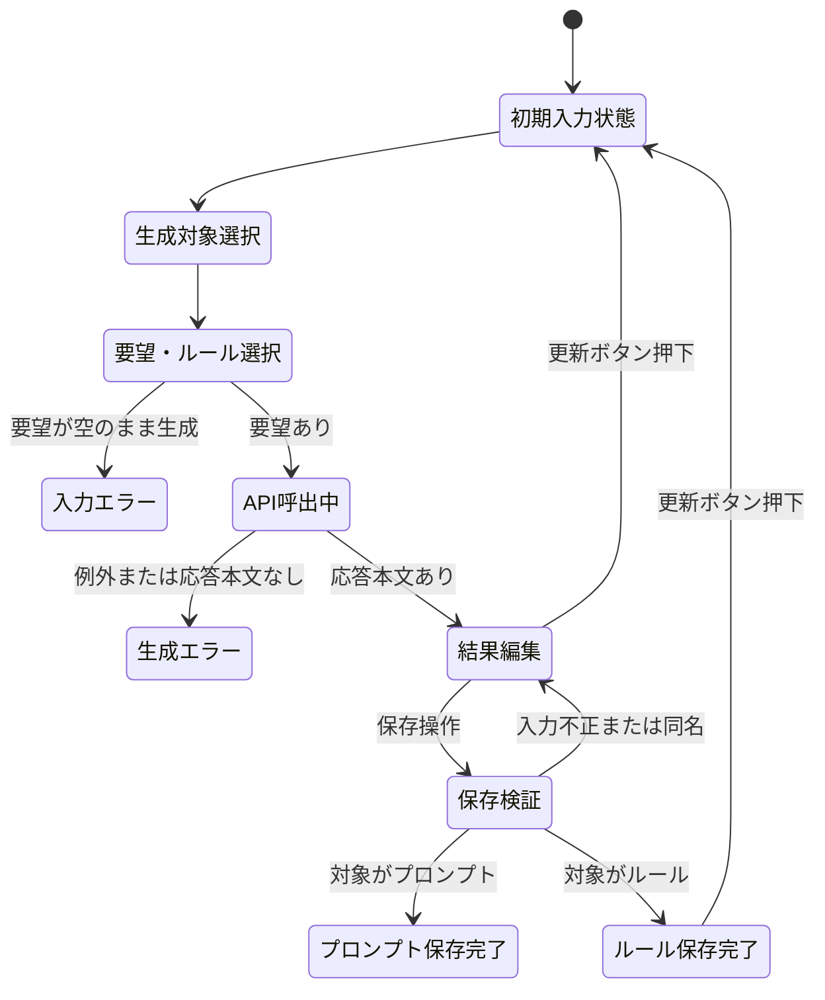

# AIプロンプト作成支援ツール 詳細設計書

## 1. 文書情報

| 項目 | 内容 |
|---|---|
| 文書名 | AIプロンプト作成支援ツール 詳細設計書 |
| 対象ソース | `app.py` |
| 作成基準 | 現行ソースコードの処理・ウィジェット・ファイル操作、および追加要求 |

## 2. モジュール構成

`app.py`をエントリポイントとし、画面制御、GUI設定、入力部品描画、生成・ファイル処理を各モジュールに分離する。

| 要素 | 詳細 |
|---|---|
| ライブラリ | `pathlib.Path`、`json`、`re`、`streamlit`、`google.genai` |
| `app.py` | `app_view.render_app()`を呼び出すStreamlitエントリポイント。 |
| `app_view.py` | 設定の読込、画面制御、GUI改良フォーム、入力・結果・管理画面の描画を担当する。 |
| `gui_config.py` | 既定設定、設定スキーマ検証、JSON読込・保存、GeminiによるGUI設定生成を担当する。 |
| `ui_renderer.py` | 設定済みの許可部品を描画し、生成要求に含める補助入力値を整形する。 |
| `prompt_service.py` | Geminiによるプロンプト／ルール生成とMarkdownファイルの列挙、検索、読込、保存、上書きを担当する。 |
| 定数 | `PROMPTS_DIR`：ソースファイルと同じディレクトリ配下の`prompts`。`RULES_DIR`：同じ階層の`rules`。`INPUT_PARAMETERS_DIR`：同じ階層の`input_parameters`。 |
| 初期化 | `prompt_service.initialize_storage()`がデータ保存先ディレクトリを作成する。 |
| GUI設定 | `gui_config.json`を読み込み、設定の検証後に画面へ渡す。ファイルがない場合は既定設定を使う。 |
| ページ設定 | 検証済みGUI設定をページタイトルへ反映し、レイアウトを`wide`に設定する。 |
| 関数 | `valid_filename(name)`：新規保存ファイル名を検証する。`reset_app_state()`：更新ボタン押下時にセッション状態を初期化する。 |
| 入力パラメータ処理 | `update_request_from_input_parameter(parameter_name, parameter_text)`：チェック状態に応じて本文を要望欄へ追加または除去する。 |
| 処理本体 | Streamlitウィジェットの条件分岐により、対象別生成、ルール選択、保存、検索、編集、ダウンロードを処理する。 |

## 3. 定数・ファイルパス

### 3.1 `PROMPTS_DIR`

```python
PROMPTS_DIR = Path(__file__).parent / "prompts"
PROMPTS_DIR.mkdir(exist_ok=True)
```

- 基準パスは`app.py`の配置ディレクトリ。
- 保存対象はこのディレクトリの直下。
- 子ディレクトリは再帰作成しない。親ディレクトリはプロジェクト配置済みであることを前提とする。

### 3.2 `RULES_DIR`

```python
RULES_DIR = Path(__file__).parent / "rules"
RULES_DIR.mkdir(exist_ok=True)
```

- `PROMPTS_DIR`と同じ基準パスの直下に置く。
- `RULES_DIR.glob("*.md")`で取得したファイルをオプションルールとして扱う。
- 各ファイルの`stem`（拡張子を除いたファイル名）を画面上のルール名にする。
- ルール本文はUTF-8で読み込む。

### 3.3 `INPUT_PARAMETERS_DIR`

```python
INPUT_PARAMETERS_DIR = Path(__file__).parent / "input_parameters"
INPUT_PARAMETERS_DIR.mkdir(exist_ok=True)
```

- `INPUT_PARAMETERS_DIR.glob("*.md")`で取得したファイルを入力パラメータとして扱う。
- ファイル名の`stem`をチェックボックスの表示名とし、本文をUTF-8で読み込む。
- チェック時は本文を要望欄へ追加し、解除時は本文の最初の一致を取り除く。

### 3.4 `gui_config.json`

- `gui_config.GUI_CONFIG_PATH`を保存先とするUTF-8 JSONファイル。
- `app_title`、`generation_heading`、`request_label`、`request_placeholders`、`request_height`、各種ラベル、`custom_fields`を保持する。
- `custom_fields`は最大8項目。許可する部品は`text_input`、`text_area`、`selectbox`、`multiselect`、`checkbox`。
- 入力補助項目は`id`、`label`、`type`、`options`、`placeholder`、`help`、`include_in_prompt`を持つ。
- 設定全体のサイズは16,384バイト以下、要望欄高さは80から500、選択肢は各項目20件以下とする。
- 設定保存は一時ファイルへ書き込んでから置換し、不完全なJSONを直接上書きしない。
- AI応答や既存JSONが不正な場合は保存せず、読込時は既定設定にフォールバックする。

### 3.5 保存ファイル名

生成対象に応じ、次のいずれかの形式で保存先を組み立てる。

```text
プロンプト: PROMPTS_DIR / (入力ファイル名.strip() + ".md")
ルール: RULES_DIR / (入力ファイル名.strip() + ".md")
入力パラメータ: INPUT_PARAMETERS_DIR / (入力ファイル名.strip() + ".md")
```

ファイル名入力値は検証に使われるが、保存時は`.strip()`した値を使用する。保存先は作成対象から決定する。入力パラメータの内容はAIを介さず、要望欄の内容をそのまま保存対象とする。既存の指示文管理画面からの手動作成・編集は`prompts`を対象とする。

## 4. 関数詳細

### 4.1 `valid_filename(name)`

**目的**：利用者入力が新規ファイル名として許容可能か判定する。

**判定条件**：以下をすべて満たす場合に`True`。

1. `name.strip()`が空ではない。
2. `Path(name).name == name`であり、パス要素を含まない。
3. `name`が`.`または`..`ではない。
4. `/`、`\`、`:`、NUL文字を含まない。

**注意**：引数の型注釈や長さ制限、OS固有の予約語チェックは実装されていない。

### 4.2 `update_request_from_input_parameter(parameter_name, parameter_text)`

**目的**：入力パラメータのチェック状態を要望入力欄へ反映する。

- チェック時は、本文が空でなく要望欄に含まれていない場合、本文を改行区切りで末尾に追加する。
- チェック解除時は、本文の最初の一致を要望欄から除去し、前後の空白を取り除く。
- チェック状態は`input_parameter_<ファイル名>`のセッションキーで取得する。

## 5. 画面処理詳細

### 5.1 共通ヘッダー

- タイトルと更新ボタンを`st.columns([8, 1])`で配置し、更新ボタンを右列に表示する。
- 更新ボタンはキー`reset_app`、コールバック`reset_app_state`を指定する。
- `reset_app_state()`は`st.session_state`のキー一覧を複製して走査し、ボタン自身のキー`reset_app`以外を削除する。
- ボタン状態は書き換えず、生成対象・生成結果・要望・ルールチェック・検索・管理モード・新規作成・編集の各状態を初期化する。
- コールバック終了後にStreamlitがスクリプトを再実行する。生成対象はラジオボタンの先頭選択肢「プロンプト」に戻り、コード先頭で最新の`RULES_DIR.glob("*.md")`結果をチェックボックスとして表示する。
- ルールファイル自体は削除・変更しない。更新は画面状態と一覧の再読込のみを行う。

### 5.2 AIによる指示文作成

#### ウィジェット

| ウィジェット | キー | 仕様 |
|---|---|---|
| 作成対象 | `generation_type` | 三択「プロンプト」「ルール」「入力パラメータ」。AI生成セクションの先頭に配置する。初期値は「プロンプト」。 |
| 流用テンプレート | `reuse_template_<ファイル名>` | `prompts/*.md`ごとにファイル名（拡張子を除く）のチェックボックスを作成する。「入力パラメータ」より前に表示する。 |
| 入力パラメータ | `input_parameter_<ファイル名>` | `input_parameters/*.md`ごとにチェックボックスを表示する。要望入力欄より上に配置し、チェック状態に応じて本文を要望欄へ追加・除去する。 |
| GUI入力補助 | `ui_field_<id>_<type>` | `gui_config.json`の`custom_fields`を`ui_renderer.render_custom_fields()`で描画する。許可済み部品のみを使用する。 |
| 要望入力 | `ai_request` | `st.text_area`。ラベルと高さは`gui_config.json`の`request_label`、`request_height`に従う。 |
| オプションルール | `option_rule_<ファイル名>` | `rules/*.md`ごとにチェックボックスを生成する。ラベルはファイル名（拡張子を除く）。複数選択可能。 |
| 生成実行 | なし | `st.button`。プロンプト／ルール用ラベルは`generate_prompt_label`、入力パラメータ用は`generate_parameter_label`に従う。primary。 |
| 保存ファイル名 | `generated_name` | 生成結果がセッションに存在する場合に表示。初期値「新しい指示文」。 |
| 生成本文 | `generated_prompt` | `st.text_area`。高さ350。生成結果を編集可能。 |
| 生成結果保存 | なし | ラベル「生成した内容をMarkdownに保存」。対象別フォルダへ保存する。 |

GUI入力補助の値は`include_in_prompt`が真かつ値が空でない場合に、ラベルと値を「補助入力」セクションとしてプロンプト／ルール生成要求に追記する。入力パラメータ作成では、従来仕様どおり要望欄の内容のみを成果物にする。

作成対象と生成結果のセッション状態は次のように管理する。

| キー | 値・用途 |
|---|---|
| `generation_type` | 画面で選択中の作成対象。値は「プロンプト」「ルール」「入力パラメータ」。初期値は「プロンプト」。 |
| `generated_type` | 直近の生成結果を生成した対象。生成成功時に`generation_type`をコピーし、結果保存先の判定に使用する。 |
| `generated_prompt` | 生成された成果物本文。プロンプト・ルールのいずれの場合も結果編集欄の値を保持する。 |
| `generated_name` | 生成結果の保存ファイル名。 |
| `option_rule_<ファイル名>` | 各ルールのチェック状態。選択されたルール本文は生成要求を作る際にファイルから再読込する。 |
| `input_parameter_<ファイル名>` | 各入力パラメータのチェック状態。チェック変更時に本文を`ai_request`へ反映する。 |
| `reuse_template_<ファイル名>` | 各流用テンプレートのチェック状態。チェック変更時に`manage_mode`を「新規作成」にし、`new_name`と`new_content`へ選択内容を設定する。 |

流用テンプレート、オプションルール、入力パラメータの表示順はファイル名順とする。各ファイルが0件の場合はチェックボックスを表示しない。選択状態はファイル名を含む一意なウィジェットキーで管理する。流用テンプレートは入力パラメータ欄の前に表示する。

#### 生成要求テンプレート

生成対象に応じてテンプレートを切り替える。

**プロンプト生成テンプレート**は、以下をモデルへ指示する。

- 日本語で、ユーザー要望を実現する指示文を作成する。
- そのままAIに入力して使える形式とする。
- 作業内容、出力形式、注意事項を整理する。
- 不明条件を事実として決めつけない。
- Markdown形式とし、前置き・解説を付けず指示文だけを出力する。
- 利用者入力を「ユーザーの要望」としてテンプレートに埋め込む。
- 選択された各ルールの名前と本文を「適用するルール」として追加し、プロンプトに反映するよう指示する。
- 選択された各流用テンプレートの名前と本文を「流用テンプレート」として追加する。本文を土台として活用し、今回の要望を盛り込み、重複・矛盾を整理するよう指示する。

**ルール生成テンプレート**は、利用者の要望から再利用可能なルール本文をMarkdown形式で作成するよう指示する。出力はルール本文のみとする。ルール生成時はオプションルールおよび流用テンプレートの選択内容を生成要求に含めない。

#### 生成処理順

1. 作成対象（プロンプト／ルール／入力パラメータ）と要望、必要に応じて流用テンプレート・オプションルール・入力パラメータを選択する。
2. 流用テンプレートのチェック変更時は、選択中のテンプレート名と本文を結合し、管理モードを「新規作成」にして管理欄へ設定する。すべて解除した場合は新規作成欄を空にする。
3. 入力パラメータのチェック変更時は、対応するMarkdown本文を要望欄へ追加または除去する。
4. 実行ボタン押下を検知し、`request.strip()`が空なら警告を表示する。
5. 作成対象が入力パラメータの場合はAIを呼び出さず、要望欄の内容を生成結果として使用する。
6. 作成対象がプロンプトまたはルールの場合は、`st.secrets["GEMINI_API_KEY"]`から認証情報を取得し、Geminiクライアントを生成する。
7. 作成対象に対応するテンプレートを組み立てる。プロンプトの場合、選択されたルールおよび流用テンプレートの本文をUTF-8で読み込み、名前とともに要求へ含める。ルールの場合はルール生成用テンプレートのみを使う。
8. AI生成時は`st.spinner`内で`with genai.Client(api_key=api_key) as client:`を使用し、コンテキスト内で`client.models.generate_content`を呼ぶ。応答取得後にClientを閉じる。モデルは`gemini-3.8-flash`。
9. AI応答本文がfalsyならエラー表示する。
10. 結果が有効なら`generated_prompt`に本文、`generated_name`に「新しい指示文」、`generated_type`に作成対象を設定する。
11. 例外はすべて捕捉し、APIキー・モデル利用可否・接続・利用制限を確認するよう案内する。詳細例外はcaptionに表示する。

APIタイムアウト、再試行、応答長制限、入力サイズ制限は明示的に設定されていない。

### 5.2.1 GUI改良フォーム

- `st.expander("GUIの改良")`内に改善案入力用`st.text_area`と`st.form_submit_button("改良")`を配置する。
- 改善案は最大2,000文字。空欄の場合は警告し、Gemini APIを呼び出さない。
- APIキーは`st.secrets["GEMINI_API_KEY"]`から取得する。
- `gui_config.generate_gui_config()`は現在設定と改善案をGeminiへ送り、JSONのみを要求する。
- `genai.Client`はコンテキストマネージャー内で使用し、応答受信後にHTTPクライアントを閉じる。
- AI応答を`json.loads()`で解析後、`validate_gui_config()`で厳密に検証する。
- 検証成功時のみ`gui_config.json`へ保存し、`st.rerun()`で新設定を反映する。
- 「GUI設定を初期化」操作は既定設定を保存し、同様に再実行する。
- AI生成のコード、HTML、式、パスなどを実行または設定へ取り込まない。

### 5.2.2 GUI設定の生成・適用フロー

1. 利用者が改善案を入力して「改良」を送信する。
2. 現在の検証済み設定JSONと改善案をGeminiへ送信する。
3. 返却本文をJSONとして解析し、`validate_gui_config()`でキー、型、長さ、項目数、部品種別、選択肢を検証する。
4. 検証失敗時はエラーを表示し、既存設定ファイルを変更しない。
5. 検証成功時は一時ファイル経由で`gui_config.json`を置換し、成功通知状態を保存する。
6. `st.rerun()`後、設定JSONを再読込し、新しい画面構成を描画する。Streamlitプロセスは終了しない。
7. 初期化操作は既定設定を同じ手順で保存して再描画する。

### 5.3 生成結果の保存

1. `generated_prompt`がセッション状態にある場合に結果編集UIを表示する。
2. 保存ボタン押下時、`valid_filename(generated_name)`を評価する。
3. ファイル名不正ならエラー表示する。
4. `generated_content.strip()`が空ならエラー表示する。
5. `generated_type`がプロンプトなら`PROMPTS_DIR`、ルールなら`RULES_DIR`、入力パラメータなら`INPUT_PARAMETERS_DIR`を保存先として選択する。
6. 選択した保存先と`generated_name.strip()`から`<ファイル名>.md`を組み立てる。
7. `exists()`が真なら重複エラーを表示する。
8. それ以外は`write_text(generated_content, encoding="utf-8")`を実行する。
9. 成功メッセージを表示し、`st.rerun()`を呼ぶ。

### 5.4 保存済みファイル列挙・検索

1. `sorted(PROMPTS_DIR.glob("*.md"))`で直下のMarkdownファイルを列挙する。
2. 検索入力値に`.strip().casefold()`を適用する。
3. キーワードが空でない場合、各ファイルについて次のいずれかを満たすものに絞る。
   - `path.stem.casefold()`にキーワードを含む。
   - `path.read_text(encoding="utf-8").casefold()`にキーワードを含む。
4. 検索後のファイル件数を表示する。

本文検索は対象ファイルを毎回読み込み、検索結果を保存・キャッシュしない。読み込み例外を個別捕捉する処理はない。

### 5.5 管理モード

`st.radio`で「新規作成」「既存の指示文を編集」のいずれかを選択し、キーは`manage_mode`とする。横並びで表示する。

#### 新規作成

- 名前入力：キー`new_name`。
- 本文入力：キー`new_content`、高さ250。
- 保存ボタン：キー`save_new`。
- 流用テンプレートの選択時は管理モードを「新規作成」に変更し、選択した1件の`stem`または複数選択時の既定名と、選択ファイル本文を区切り線で結合した内容を各入力欄へ設定する。
- 保存時にファイル名、本文の空値、同名ファイルを順に検査する。
- 成功時、UTF-8で保存し、成功通知を表示する。次回再実行で要望欄を空にするための状態を設定してから`st.rerun()`する。

#### 既存編集

- 検索後のファイルが0件なら情報メッセージを表示する。
- `st.selectbox`で対象を選択する。表示文字列は拡張子を除いたファイル名。
- 選択ファイルをUTF-8で読み込み、編集欄に初期値として設定する。
- 編集欄キーは`edit_<ファイル名>`、高さ300。
- ダウンロードボタンは編集欄の値を`data`として渡し、元のファイル名とMIMEタイプ`text/markdown`を設定する。
- 保存ボタン（キー`save_edit`）押下時、編集欄の内容を選択ファイルにUTF-8で上書きし、成功通知後に再実行する。
- 編集時には空本文の拒否、同時更新検出、ファイル消失確認を行わない。

## 6. データフローと状態遷移

### 6.1 AI生成の状態



### 6.2 ファイルデータ

- ルール選択肢：`rules/*.md`を列挙し、ファイル名を表示ラベル、ファイル本文を生成時のルール内容として扱う。
- 流用テンプレート選択肢：`prompts/*.md`を列挙し、ファイル名を表示ラベル、ファイル本文を管理欄の事前入力およびプロンプト生成時の土台として扱う。
- 入力パラメータ選択肢：`input_parameters/*.md`を列挙し、ファイル名を表示ラベル、ファイル本文を要望欄へ反映する内容として扱う。
- 既存プロンプトを流用して新規作成する場合も、保存は新規ファイルとして扱い、既存ファイルの上書きは行わない。
- 新規作成・プロンプト生成保存：`prompts`を保存先として新規ファイルに書き込む。
- ルール生成保存：`rules`を保存先として新規ファイルに書き込む。保存したルールは次回以降のルール選択肢に含まれる。
- 検索・選択：`prompts/*.md`を列挙して読み込む。
- 編集保存：選択ファイルを上書きする。
- ダウンロード：編集欄の現在値をブラウザーに返す。ダウンロードのみではサーバー側ファイルを変更しない。

### 6.3 画面状態の初期化

1. `reset_app`ボタンのコールバックで、`st.session_state`内の全キーを列挙する。
2. `reset_app`キーを除く全キーを削除する。生成内容やフォーム値は保存先ファイルには影響しない。
3. Streamlitによる通常の再実行後、ウィジェットは初期値で描画される。
4. `generation_type`は「プロンプト」に戻るため、ルール生成後でもオプションルール一覧を表示する。
5. 起動時・再実行時に`rules/*.md`を列挙するため、保存済みの新規ルールも選択可能になる。

### 6.4 GUI設定の改良と再描画

1. 利用者が「GUIの改良」フォームに改善案を入力する。
2. `gui_config.generate_gui_config()`が改善案と現在の設定をGeminiへ送り、設定JSON案を取得する。
3. JSON解析と`validate_gui_config()`の検証が成功した場合に限り、`save_gui_config()`で一時ファイルから`gui_config.json`を置換する。
4. 検証または保存が失敗した場合は既存設定を保持し、エラーを画面表示する。
5. 成功後に`st.rerun()`を呼び、`render_app()`が設定を再読込して画面を再描画する。アプリケーションプロセスは停止しない。
6. 「GUI設定を初期化」は`DEFAULT_GUI_CONFIG`を保存して再描画する。

## 7. エラー・境界条件

| 発生条件 | 設計上の動作 |
|---|---|
| 更新ボタン押下 | 更新ボタン以外のセッション状態を消去し、画面入力と生成結果を初期化する。保存済みファイルは変更しない。 |
| GUI改善案が空 | 警告を表示し、Gemini APIを呼び出さない。 |
| AI応答がJSONでない、またはスキーマ不正 | 設定を保存せず、既存GUI設定を維持してエラーを表示する。 |
| `gui_config.json`が存在しない | 既定設定で画面を描画する。 |
| `gui_config.json`が破損、または設定内容が不正 | 既定設定で画面を描画し、設定エラーを通知する。 |
| 許可されていない入力部品タイプや項目が設定された | スキーマ検証で拒否し、画面やコードとして実行しない。 |
| GUI設定初期化を選択 | 既定設定を保存して再描画する。Markdownデータは変更しない。 |
| `rules`にMarkdownファイルがない | オプションルールを未選択として扱い、チェックボックスなしで生成できる。 |
| `input_parameters`にMarkdownファイルがない | 入力パラメータのチェックボックスを表示しない。 |
| 入力パラメータを選択 | 対応する本文を要望欄へ追加する。選択解除時は本文の最初の一致を取り除く。 |
| 入力パラメータを作成 | Gemini APIを呼ばず、要望欄の内容を結果欄に設定する。保存先は`input_parameters`とする。 |
| `prompts`にMarkdownファイルがある | ファイル名（拡張子を除く）を流用テンプレートのチェックボックスとして、入力パラメータ欄より前に表示する。 |
| 流用テンプレートを選択 | 管理モードを新規作成に切り替え、選択したプロンプト名と本文を管理欄に表示する。複数選択時は本文を区切り線で結合する。 |
| プロンプト生成時に流用テンプレートを選択 | 選択テンプレート本文と利用者の要望をGeminiへ渡し、テンプレートを土台に要望を盛り込んだ新規プロンプトを生成する。 |
| 選択したルールファイルの読込に失敗 | 個別の利用者向け回復動作は未定義。エラーを捕捉して生成を中断する設計とする。 |
| ルール生成時にオプションルールが選択されている | 選択状態は保持しても、ルール生成要求には含めない。 |
| 生成対象に対応する保存先に同名ファイルがある | 重複エラーとし、上書きしない。もう一方のフォルダに同名ファイルがあっても別ファイルとして扱う。 |
| AI要望が空白のみ | 警告を表示し、生成処理を行わない。 |
| APIキー欠落、SDK/API例外等 | 例外を捕捉して共通エラーと詳細例外を表示する。 |
| API応答本文が空 | 生成結果取得エラーを表示する。 |
| 新規ファイル名が不正 | ファイル名エラーを表示する。 |
| 新規保存本文が空白のみ | 本文エラーを表示する。 |
| 新規保存先が既に存在 | 重複エラーとし、上書きしない。 |
| 検索結果が空 | 件数0と、該当なしメッセージを表示する。 |
| ファイル読込・書込のOS例外 | 個別処理がないため、Streamlit実行時例外となる可能性がある。 |
| 編集中に外部からファイルが変更 | 保存時に検出せず、編集値で上書きする。 |

## 8. 設定・起動に関する情報

- 必須Secretsキー：`GEMINI_API_KEY`
- 参照方法：`st.secrets`。
- `.streamlit/secrets.toml`の存在は確認できるが、その内容は機密情報であり本設計書には記載しない。
- AI生成物は検証済みJSONとしてのみ扱い、Pythonコード、HTML、任意式、ファイルパス等として実行しない。
- GUI設定は表示文言と許可済み入力部品に限定し、ファイル保存先や外部API接続先をAIに変更させない。
- 実行コマンドや依存バージョンはリポジトリ内の設定資料から特定できない。通常のStreamlitアプリとしての起動が想定されるが、正式な起動手順は要確認。
- `requirements.txt`等の依存パッケージ固定情報は確認できない。

## 9. 実装上の制約・改善検討事項

以下は現状の記録であり、変更要求ではない。

- API呼び出しの例外詳細が画面に表示されるため、公開環境では機密情報や内部情報の露出を確認する。
- `exists()`確認後の書き込みは原子的な新規作成ではなく、並行実行時の同名競合を完全には防がない。
- 検索時に全対象ファイルを読み込むため、ファイル数・容量が増加した場合の応答時間を確認する。
- ファイルI/O例外、文字コード不正、ファイル削除済みケースの利用者向け処理はない。
- `valid_filename`に型注釈、ファイル名長、OS予約名等の追加制約はない。
- 選択対象の変更時に編集ウィジェット状態が正しく切り替わることを、実環境で確認する。
- 選択ルール同士が矛盾する場合の優先順位は定義されていない。
- オプションルールのチェック状態を変更したとき、生成対象を切り替えたときの状態保持方針は実装時に確認する。
