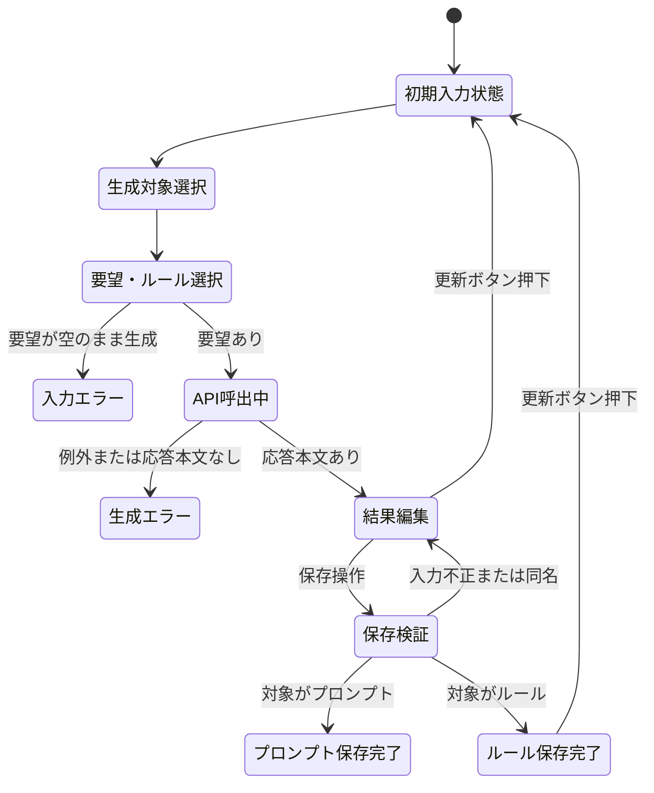

# AI指示文管理ツール 詳細設計書

## 1. 文書情報

| 項目 | 内容 |
|---|---|
| 文書名 | AI指示文管理ツール 詳細設計書 |
| 対象ソース | `app.py` |
| 作成基準 | 現行ソースコードの処理・ウィジェット・ファイル操作、および追加要求 |

## 2. モジュール構成

アプリケーション処理は`app.py`に集約される。独立した業務ロジックモジュール、データアクセス層、APIラッパーモジュールは存在しない。

| 要素 | 詳細 |
|---|---|
| ライブラリ | `pathlib.Path`、`streamlit`、`google.genai` |
| 定数 | `PROMPTS_DIR`：ソースファイルと同じディレクトリ配下の`prompts`。`RULES_DIR`：同じ階層の`rules`。`INPUT_PARAMETERS_DIR`：同じ階層の`input_parameters`。 |
| 初期化 | `PROMPTS_DIR`、`RULES_DIR`および`INPUT_PARAMETERS_DIR`を作成する。 |
| ページ設定 | ページタイトルを「AI指示文管理ツール」、レイアウトを`wide`に設定する。 |
| 関数 | `valid_filename(name)`：新規保存ファイル名を検証する。`reset_app_state()`：更新ボタン押下時にセッション状態を初期化する。 |
| 入力パラメータ処理 | `update_request_from_input_parameter(parameter_name, parameter_text)`：チェック状態に応じて本文を要望欄へ追加または除去する。 |
| 処理本体 | Streamlitウィジェットの条件分岐により、対象別生成、ルール選択、保存、検索、編集、ダウンロードを処理する。 |

## 3. 定数・ファイルパス

### 3.1 `PROMPTS_DIR`

```python
PROMPTS_DIR = Path(__file__).parent / "prompts"
PROMPTS_DIR.mkdir(exist_ok=True)
```

- 基準パスは`app.py`の配置ディレクトリ。
- 保存対象はこのディレクトリの直下。
- 子ディレクトリは再帰作成しない。親ディレクトリはプロジェクト配置済みであることを前提とする。

### 3.2 `RULES_DIR`

```python
RULES_DIR = Path(__file__).parent / "rules"
RULES_DIR.mkdir(exist_ok=True)
```

- `PROMPTS_DIR`と同じ基準パスの直下に置く。
- `RULES_DIR.glob("*.md")`で取得したファイルをオプションルールとして扱う。
- 各ファイルの`stem`（拡張子を除いたファイル名）を画面上のルール名にする。
- ルール本文はUTF-8で読み込む。

### 3.3 `INPUT_PARAMETERS_DIR`

```python
INPUT_PARAMETERS_DIR = Path(__file__).parent / "input_parameters"
INPUT_PARAMETERS_DIR.mkdir(exist_ok=True)
```

- `INPUT_PARAMETERS_DIR.glob("*.md")`で取得したファイルを入力パラメータとして扱う。
- ファイル名の`stem`をチェックボックスの表示名とし、本文をUTF-8で読み込む。
- チェック時は本文を要望欄へ追加し、解除時は本文の最初の一致を取り除く。

### 3.2 保存ファイル名

生成対象に応じ、次のいずれかの形式で保存先を組み立てる。

```text
プロンプト: PROMPTS_DIR / (入力ファイル名.strip() + ".md")
ルール: RULES_DIR / (入力ファイル名.strip() + ".md")
入力パラメータ: INPUT_PARAMETERS_DIR / (入力ファイル名.strip() + ".md")
```

ファイル名入力値は検証に使われるが、保存時は`.strip()`した値を使用する。保存先は作成対象から決定する。入力パラメータの内容はAIを介さず、要望欄の内容をそのまま保存対象とする。既存の指示文管理画面からの手動作成・編集は`prompts`を対象とする。

## 4. 関数詳細

### 4.1 `valid_filename(name)`

**目的**：利用者入力が新規ファイル名として許容可能か判定する。

**判定条件**：以下をすべて満たす場合に`True`。

1. `name.strip()`が空ではない。
2. `Path(name).name == name`であり、パス要素を含まない。
3. `name`が`.`または`..`ではない。
4. `/`、`\`、`:`、NUL文字を含まない。

**注意**：引数の型注釈や長さ制限、OS固有の予約語チェックは実装されていない。

### 4.2 `update_request_from_input_parameter(parameter_name, parameter_text)`

**目的**：入力パラメータのチェック状態を要望入力欄へ反映する。

- チェック時は、本文が空でなく要望欄に含まれていない場合、本文を改行区切りで末尾に追加する。
- チェック解除時は、本文の最初の一致を要望欄から除去し、前後の空白を取り除く。
- チェック状態は`input_parameter_<ファイル名>`のセッションキーで取得する。

## 5. 画面処理詳細

### 5.1 共通ヘッダー

- タイトルと更新ボタンを`st.columns([8, 1])`で配置し、更新ボタンを右列に表示する。
- 更新ボタンはキー`reset_app`、コールバック`reset_app_state`を指定する。
- `reset_app_state()`は`st.session_state`のキー一覧を複製して走査し、ボタン自身のキー`reset_app`以外を削除する。
- ボタン状態は書き換えず、生成対象・生成結果・要望・ルールチェック・検索・管理モード・新規作成・編集の各状態を初期化する。
- コールバック終了後にStreamlitがスクリプトを再実行する。生成対象はラジオボタンの先頭選択肢「プロンプト」に戻り、コード先頭で最新の`RULES_DIR.glob("*.md")`結果をチェックボックスとして表示する。
- ルールファイル自体は削除・変更しない。更新は画面状態と一覧の再読込のみを行う。

### 5.2 AIによる指示文作成

#### ウィジェット

| ウィジェット | キー | 仕様 |
|---|---|---|
| 作成対象 | `generation_type` | 三択「プロンプト」「ルール」「入力パラメータ」。AI生成セクションの先頭に配置する。初期値は「プロンプト」。 |
| 入力パラメータ | `input_parameter_<ファイル名>` | `input_parameters/*.md`ごとにチェックボックスを表示する。要望入力欄より上に配置し、チェック状態に応じて本文を要望欄へ追加・除去する。 |
| 要望入力 | `ai_request` | `st.text_area`。高さ120。 |
| オプションルール | `option_rule_<ファイル名>` | `rules/*.md`ごとにチェックボックスを生成する。ラベルはファイル名（拡張子を除く）。複数選択可能。 |
| 生成実行 | なし | `st.button`。ラベル「AIで指示文を生成」、primary。 |
| 保存ファイル名 | `generated_name` | 生成結果がセッションに存在する場合に表示。初期値「新しい指示文」。 |
| 生成本文 | `generated_prompt` | `st.text_area`。高さ350。生成結果を編集可能。 |
| 生成結果保存 | なし | ラベル「生成した内容をMarkdownに保存」。対象別フォルダへ保存する。 |

作成対象と生成結果のセッション状態は次のように管理する。

| キー | 値・用途 |
|---|---|
| `generation_type` | 画面で選択中の作成対象。値は「プロンプト」「ルール」「入力パラメータ」。初期値は「プロンプト」。 |
| `generated_type` | 直近の生成結果を生成した対象。生成成功時に`generation_type`をコピーし、結果保存先の判定に使用する。 |
| `generated_prompt` | 生成された成果物本文。プロンプト・ルールのいずれの場合も結果編集欄の値を保持する。 |
| `generated_name` | 生成結果の保存ファイル名。 |
| `option_rule_<ファイル名>` | 各ルールのチェック状態。選択されたルール本文は生成要求を作る際にファイルから再読込する。 |
| `input_parameter_<ファイル名>` | 各入力パラメータのチェック状態。チェック変更時に本文を`ai_request`へ反映する。 |

オプションルールおよび入力パラメータの表示順はファイル名順とする。各ファイルが0件の場合はチェックボックスを表示しない。選択状態はファイル名を含む一意なウィジェットキーで管理する。入力パラメータのチェックボックス群は要望入力欄の上に配置する。

#### 生成要求テンプレート

生成対象に応じてテンプレートを切り替える。

**プロンプト生成テンプレート**は、以下をモデルへ指示する。

- 日本語で、ユーザー要望を実現する指示文を作成する。
- そのままAIに入力して使える形式とする。
- 作業内容、出力形式、注意事項を整理する。
- 不明条件を事実として決めつけない。
- Markdown形式とし、前置き・解説を付けず指示文だけを出力する。
- 利用者入力を「ユーザーの要望」としてテンプレートに埋め込む。
- 選択された各ルールの名前と本文を「適用するルール」として追加し、プロンプトに反映するよう指示する。

**ルール生成テンプレート**は、利用者の要望から再利用可能なルール本文をMarkdown形式で作成するよう指示する。出力はルール本文のみとする。ルール生成時はオプションルールの選択内容をテンプレートに含めない。

#### 生成処理順

1. 作成対象（プロンプト／ルール／入力パラメータ）と要望、必要に応じてオプションルール・入力パラメータを選択する。
2. 入力パラメータのチェック変更時は、対応するMarkdown本文を要望欄へ追加または除去する。
3. 実行ボタン押下を検知し、`request.strip()`が空なら警告を表示する。
4. 作成対象が入力パラメータの場合はAIを呼び出さず、要望欄の内容を生成結果として使用する。
5. 作成対象がプロンプトまたはルールの場合は、`st.secrets["GEMINI_API_KEY"]`から認証情報を取得し、Geminiクライアントを生成する。
6. 作成対象に対応するテンプレートを組み立てる。プロンプトの場合、選択されたルールファイルの本文をUTF-8で読み込み、ルール名とともにテンプレートへ加える。ルールの場合はルール生成用テンプレートを使う。
7. AI生成時は`st.spinner`内で`client.models.generate_content`を呼ぶ。モデルは`gemini-3.8-flash`。
8. AI応答本文がfalsyならエラー表示する。
9. 結果が有効なら`generated_prompt`に本文、`generated_name`に「新しい指示文」、`generated_type`に作成対象を設定する。
10. 例外はすべて捕捉し、APIキー・モデル利用可否・接続・利用制限を確認するよう案内する。詳細例外はcaptionに表示する。

APIタイムアウト、再試行、応答長制限、入力サイズ制限は明示的に設定されていない。

### 5.3 生成結果の保存

1. `generated_prompt`がセッション状態にある場合に結果編集UIを表示する。
2. 保存ボタン押下時、`valid_filename(generated_name)`を評価する。
3. ファイル名不正ならエラー表示する。
4. `generated_content.strip()`が空ならエラー表示する。
5. `generated_type`がプロンプトなら`PROMPTS_DIR`、ルールなら`RULES_DIR`、入力パラメータなら`INPUT_PARAMETERS_DIR`を保存先として選択する。
6. 選択した保存先と`generated_name.strip()`から`<ファイル名>.md`を組み立てる。
7. `exists()`が真なら重複エラーを表示する。
8. それ以外は`write_text(generated_content, encoding="utf-8")`を実行する。
9. 成功メッセージを表示し、`st.rerun()`を呼ぶ。

### 5.4 保存済みファイル列挙・検索

1. `sorted(PROMPTS_DIR.glob("*.md"))`で直下のMarkdownファイルを列挙する。
2. 検索入力値に`.strip().casefold()`を適用する。
3. キーワードが空でない場合、各ファイルについて次のいずれかを満たすものに絞る。
   - `path.stem.casefold()`にキーワードを含む。
   - `path.read_text(encoding="utf-8").casefold()`にキーワードを含む。
4. 検索後のファイル件数を表示する。

本文検索は対象ファイルを毎回読み込み、検索結果を保存・キャッシュしない。読み込み例外を個別捕捉する処理はない。

### 5.5 管理モード

`st.radio`で「新規作成」「既存の指示文を編集」のいずれかを選択し、キーは`manage_mode`とする。横並びで表示する。

#### 新規作成

- 名前入力：キー`new_name`。
- 本文入力：キー`new_content`、高さ250。
- 保存ボタン：キー`save_new`。
- 保存時にファイル名、本文の空値、同名ファイルを順に検査する。
- 成功時、UTF-8で保存し、成功通知を表示する。次回再実行で要望欄を空にするための状態を設定してから`st.rerun()`する。

#### 既存編集

- 検索後のファイルが0件なら情報メッセージを表示する。
- `st.selectbox`で対象を選択する。表示文字列は拡張子を除いたファイル名。
- 選択ファイルをUTF-8で読み込み、編集欄に初期値として設定する。
- 編集欄キーは`edit_<ファイル名>`、高さ300。
- ダウンロードボタンは編集欄の値を`data`として渡し、元のファイル名とMIMEタイプ`text/markdown`を設定する。
- 保存ボタン（キー`save_edit`）押下時、編集欄の内容を選択ファイルにUTF-8で上書きし、成功通知後に再実行する。
- 編集時には空本文の拒否、同時更新検出、ファイル消失確認を行わない。

## 6. データフローと状態遷移

### 6.1 AI生成の状態



### 6.2 ファイルデータ

- ルール選択肢：`rules/*.md`を列挙し、ファイル名を表示ラベル、ファイル本文を生成時のルール内容として扱う。
- 入力パラメータ選択肢：`input_parameters/*.md`を列挙し、ファイル名を表示ラベル、ファイル本文を要望欄へ反映する内容として扱う。
- 新規作成・プロンプト生成保存：`prompts`を保存先として新規ファイルに書き込む。
- ルール生成保存：`rules`を保存先として新規ファイルに書き込む。保存したルールは次回以降のルール選択肢に含まれる。
- 検索・選択：`prompts/*.md`を列挙して読み込む。
- 編集保存：選択ファイルを上書きする。
- ダウンロード：編集欄の現在値をブラウザーに返す。ダウンロードのみではサーバー側ファイルを変更しない。

### 6.3 画面状態の初期化

1. `reset_app`ボタンのコールバックで、`st.session_state`内の全キーを列挙する。
2. `reset_app`キーを除く全キーを削除する。生成内容やフォーム値は保存先ファイルには影響しない。
3. Streamlitによる通常の再実行後、ウィジェットは初期値で描画される。
4. `generation_type`は「プロンプト」に戻るため、ルール生成後でもオプションルール一覧を表示する。
5. 起動時・再実行時に`rules/*.md`を列挙するため、保存済みの新規ルールも選択可能になる。

## 7. エラー・境界条件

| 発生条件 | 設計上の動作 |
|---|---|
| 更新ボタン押下 | 更新ボタン以外のセッション状態を消去し、画面入力と生成結果を初期化する。保存済みファイルは変更しない。 |
| `rules`にMarkdownファイルがない | オプションルールを未選択として扱い、チェックボックスなしで生成できる。 |
| `input_parameters`にMarkdownファイルがない | 入力パラメータのチェックボックスを表示しない。 |
| 入力パラメータを選択 | 対応する本文を要望欄へ追加する。選択解除時は本文の最初の一致を取り除く。 |
| 入力パラメータを作成 | Gemini APIを呼ばず、要望欄の内容を結果欄に設定する。保存先は`input_parameters`とする。 |
| 選択したルールファイルの読込に失敗 | 個別の利用者向け回復動作は未定義。エラーを捕捉して生成を中断する設計とする。 |
| ルール生成時にオプションルールが選択されている | 選択状態は保持しても、ルール生成要求には含めない。 |
| 生成対象に対応する保存先に同名ファイルがある | 重複エラーとし、上書きしない。もう一方のフォルダに同名ファイルがあっても別ファイルとして扱う。 |
| AI要望が空白のみ | 警告を表示し、生成処理を行わない。 |
| APIキー欠落、SDK/API例外等 | 例外を捕捉して共通エラーと詳細例外を表示する。 |
| API応答本文が空 | 生成結果取得エラーを表示する。 |
| 新規ファイル名が不正 | ファイル名エラーを表示する。 |
| 新規保存本文が空白のみ | 本文エラーを表示する。 |
| 新規保存先が既に存在 | 重複エラーとし、上書きしない。 |
| 検索結果が空 | 件数0と、該当なしメッセージを表示する。 |
| ファイル読込・書込のOS例外 | 個別処理がないため、Streamlit実行時例外となる可能性がある。 |
| 編集中に外部からファイルが変更 | 保存時に検出せず、編集値で上書きする。 |

## 8. 設定・起動に関する情報

- 必須Secretsキー：`GEMINI_API_KEY`
- 参照方法：`st.secrets`。
- `.streamlit/secrets.toml`の存在は確認できるが、その内容は機密情報であり本設計書には記載しない。
- 実行コマンドや依存バージョンはリポジトリ内の設定資料から特定できない。通常のStreamlitアプリとしての起動が想定されるが、正式な起動手順は要確認。
- `requirements.txt`等の依存パッケージ固定情報は確認できない。

## 9. 実装上の制約・改善検討事項

以下は現状の記録であり、変更要求ではない。

- API呼び出しの例外詳細が画面に表示されるため、公開環境では機密情報や内部情報の露出を確認する。
- `exists()`確認後の書き込みは原子的な新規作成ではなく、並行実行時の同名競合を完全には防がない。
- 検索時に全対象ファイルを読み込むため、ファイル数・容量が増加した場合の応答時間を確認する。
- ファイルI/O例外、文字コード不正、ファイル削除済みケースの利用者向け処理はない。
- `valid_filename`に型注釈、ファイル名長、OS予約名等の追加制約はない。
- 選択対象の変更時に編集ウィジェット状態が正しく切り替わることを、実環境で確認する。
- 選択ルール同士が矛盾する場合の優先順位は定義されていない。
- オプションルールのチェック状態を変更したとき、生成対象を切り替えたときの状態保持方針は実装時に確認する。
