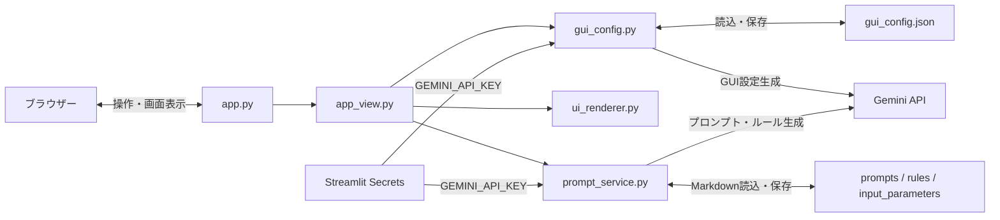

# AIプロンプト作成支援ツール ソースコード全体像

## 1. プロジェクト概要

本プロジェクトは、利用者の要望からGemini APIでプロンプトや開発ルールを作成し、Markdownファイルとして管理するStreamlit製Webアプリケーションです。入力パラメータや既存プロンプトの流用、画面設定JSONのAI改良にも対応しています。

画面はStreamlitがサーバー側で描画し、ブラウザーからの操作ごとにPythonスクリプトを再実行する構成です。独立したフロントエンドSPAやREST APIサーバーは確認できません。

## 2. 想定される技術スタック

| 分類 | 確認できた技術・構成 |
|---|---|
| 言語 | Python。プロジェクトとしての最低対応バージョンは未確認。 |
| Webフレームワーク | Streamlit。画面表示、入力、セッション状態、再描画を担当する。 |
| 生成AI | `google-genai` SDK経由でGoogle Gemini APIを利用する。ソース指定モデルは`gemini-3.8-flash`。 |
| データ保存 | `prompts`、`rules`、`input_parameters`以下のMarkdownファイルと、ルートの`gui_config.json`。データベースは確認できない。 |
| 設定・秘密情報 | `.streamlit/config.toml`でStreamlitの画面設定を指定し、APIキーはStreamlit Secretsの`GEMINI_API_KEY`から取得する。 |
| テスト | Python標準の`unittest`と`streamlit.testing.v1.AppTest`。Gemini通信はモック化している。 |
| ローカル実測環境 | Python 3.15.0、Streamlit 1.66.0、google-genai 2.31.0。これは現在の`.venv`の実測値であり、プロジェクトの固定バージョンではない。 |
| インフラ | ローカル実行とローカルファイルシステムを前提としているように見える。Docker、クラウド配置、CI/CDの定義ファイルは確認できない。 |

`requirements.txt`、`pyproject.toml`、ロックファイル等の依存定義が見当たらず、再現可能な環境構築方法や正式なサポートPythonバージョンは未確定です。

## 3. ディレクトリ構成と役割

| パス | 役割 |
|---|---|
| `app.py` | Streamlitのエントリポイント。`app_view.render_app()`を呼び出す。 |
| `app_view.py` | 画面の組み立て、フォーム操作、画面状態、AI生成・保存処理の呼び出しを制御する。 |
| `gui_config.py` | `gui_config.json`の既定値、スキーマ検証、読込・保存、GeminiによるGUI設定案の生成を担当する。 |
| `gui_config.json` | 画面タイトル、表示ラベル、プレースホルダー、要望欄の高さ、追加入力部品を保持する。 |
| `ui_renderer.py` | 設定で許可された入力部品を描画し、その値をプロンプト生成用の補足情報に整形する。 |
| `prompt_service.py` | Markdownファイルの列挙・検索・読込・保存と、Geminiによるプロンプト／ルール生成を担当する。 |
| `prompts/` | プロンプトのMarkdownを保存する。保存済みプロンプトの検索・編集対象であり、生成時の「流用テンプレート」にも使う。 |
| `rules/` | ルールのMarkdownを保存する。プロンプト生成時に選択して適用できる。 |
| `input_parameters/` | 入力欄へ追加する語句等をMarkdownで保存する。チェックボックスで要望欄に反映する。 |
| `tests/test_gui_config.py` | 設定検証、AI応答のJSON処理、GUI改良、流用テンプレート連携などを検証する。 |
| `documents/01_requirements_specification/` | 要求仕様書。 |
| `documents/02_basic_design/` | 基本設計書。 |
| `documents/03_detail_design/` | 詳細設計書。 |
| `documents/04_implementation/` | 実装関連資料。本概要資料の配置先。 |
| `documents/05_unit_testing/`、`documents/06_integration_testing/` | 単体・結合テスト関連資料用のディレクトリ。現時点で内容の有無や運用方法は未確認。 |
| `prompts/`、`rules/`、`input_parameters/`内のMarkdown | 実行時データ。ファイル名（拡張子を除く）を画面上の名前として扱う。 |
| `.streamlit/config.toml` | Streamlitのツールバー表示設定。 |
| `.streamlit/secrets.toml` | APIキー等の秘密情報を置く場所。値はこの資料に記載しない。`.gitignore`でGit追跡対象から除外されている。 |
| `.gitignore` | 現在は`.streamlit/secrets.toml`を除外する。その他のローカルデータや仮想環境の除外方針は要確認。 |
| `.venv/` | 現在のローカルPython仮想環境。実行環境の作成手順や依存固定ファイルは確認できない。 |
| `.agents/` | Streamlit開発用のエージェントスキル等を含む開発支援資料。アプリ実行時の機能ではない。 |

## 4. 全体アーキテクチャと処理フロー

### アーキテクチャ

MVCやクリーンアーキテクチャを厳密に採用した構成ではありません。Streamlitの単一プロセス内で、エントリポイント、画面制御、設定管理、部品描画、ファイル／Gemini処理をモジュール単位に分けた構成です。データはローカルファイルシステム、生成処理は外部Gemini APIに依存します。

### 起動と通常表示

1. `streamlit run app.py`で起動する。
2. `app.py`から`render_app()`を呼ぶ。
3. `gui_config.json`を読み込み、設定を検証する。不在または不正の場合は既定設定を使用する。
4. Markdown保存先ディレクトリを用意し、`app_view.py`が設定駆動の画面と既存の指示文管理画面を描画する。
5. ユーザー操作後はStreamlitがスクリプトを再実行し、画面状態は`st.session_state`で保持・初期化する。

### プロンプト・ルール作成

- 要望、必要なオプションルール、流用テンプレートを選択する。
- プロンプトの場合は選択したルールと既存プロンプト本文を要望と合わせてGeminiへ送り、結果を画面で編集して`prompts/`へ保存する。
- ルールの場合は要望をGeminiへ送り、結果を`rules/`へ保存する。
- 入力パラメータの場合はGeminiを呼ばず、要望欄の内容をそのまま結果として`input_parameters/`へ保存する。
- 生成物の保存は同名ファイルを拒否する。保存済みプロンプトの管理画面では検索、編集、上書き保存、ダウンロードができる。

### 流用テンプレート

`prompts/*.md`をチェックボックスとして表示します。選択すると管理画面を新規作成モードに切り替え、プロンプト名と本文を事前入力します。複数選択時は内容を区切り線で連結します。プロンプト生成時は、選択テンプレートを土台として新しい要望を統合するようGeminiへ指示します。保存時は新規ファイルとして扱い、既存ファイルは上書きしません。

### GUIのAI改良

利用者の改善案と現在の画面設定をGeminiへ送り、設定JSON案を受け取ります。`gui_config.py`でスキーマ検証し、成功した場合だけ設定ファイルへ保存して`st.rerun()`で再描画します。許可される入力部品は`text_input`、`text_area`、`selectbox`、`multiselect`、`checkbox`に限定され、AIが生成したPythonコードを実行する構成ではありません。

## 5. 開発着手前の注意点・要確認事項

### コードベースの特徴

- 画面変更はコード変更ではなく、主に`gui_config.json`の設定変更として扱う設計です。
- プロンプトやルール等はDBではなくMarkdownファイルで管理します。検索・一覧取得はローカルファイルを直接走査します。
- Gemini Clientは同期呼び出しで、HTTP通信中はStreamlitの処理を待ちます。API遅延・失敗は画面操作にも影響します。
- GUI設定はキー、型、文字数、入力部品数などを検証してから適用します。新しい入力部品種別や処理ロジックの追加は、設定JSONだけでは完結せず、描画コードの拡張が必要です。
- テストは`python -m unittest discover -s tests -v`で実行できます。Gemini APIとの実通信、デプロイ後の画面操作を網羅するテストは確認できません。

### 事前に確認すべき事項

- **依存関係の固定**：`requirements.txt`等がないため、開発者間・本番間のバージョン差をどう防ぐか確認してください。上記のバージョンは現在のローカル環境だけの実測値です。
- **Gemini API**：`gemini-3.8-flash`の利用可否、APIキーの権限・利用制限・課金、接続先のネットワーク条件を確認してください。
- **配置と永続性**：クラウドやコンテナへ配置する場合、ローカルのMarkdownと`gui_config.json`が再起動後も保持されるか、永続ボリューム等が必要か確認してください。
- **複数利用者**：ファイル共有、同時編集、同名保存競合に対する制御や利用者別データ分離は確認できません。
- **アクセス制御**：ログイン・権限管理は確認できません。外部公開する場合は認証、公開範囲、保存データへのアクセス制御を別途検討してください。
- **秘密情報**：APIキーは`.streamlit/secrets.toml`等で管理し、値をソース・設定JSON・文書・ログへ含めないでください。`.gitignore`の適用範囲も開発環境で確認してください。
- **データ運用**：MarkdownファイルやGUI設定のバックアップ、復元、削除、履歴管理、破損時の対応方針は未確認です。
- **テストと運用**：CI、デプロイ手順、監視、ログ保管、障害時の再試行やタイムアウトは確認できません。
- **文書と実装の同期**：要求・基本・詳細設計書が存在します。機能変更時は実装だけでなく関連文書も更新してください。
